# 🎓 University Data Platform MVP

> © 2026 University Data Platform — Plateforme de données moderne pour le contexte universitaire marocain.
> **Version 1.0 (Livrable Final - Challenge MVP)**

Une plateforme de données **end-to-end** qui unifie l'ingestion web (scraping), le stockage Lakehouse (MinIO + Hudi), le traitement Big Data (Spark), l'indexation sémantique (Qdrant), la recherche full-text (Elasticsearch), la génération augmentée (RAG Gemini) et la Business Intelligence (Metabase) dans une architecture **Medallion** conteneurisée.


La **University Data Platform** est un Data Lakehouse universitaire complet qui collecte, transforme, stocke et expose les données de toutes les facultés  
L'objectif est de créer un système unique et intelligent permettant de :
- Centraliser les informations dispersées sur les sites web des facultés.
- Offrir un moteur de recherche par mots-clés (Elasticsearch).
- Offrir une recherche sémantique (comprendre le sens des questions via Qdrant).
- Proposer un assistant IA (RAG) qui génère des réponses en langage naturel.
- Surveiller l'état de santé de tous les pipelines de données (Observabilité).

## La plateforme suit l'architecture Medallion Lakehouse (Bronze → Silver → Gold) orchestrée par Apache Airflow.
# 01 - Ingestion des Données (Zone Bronze)

## Vue d'ensemble
L'ingestion est la première étape du pipeline. Elle consiste à collecter les données brutes depuis deux types de sources :
1. **Les sites web des facultés** (via le crawler web).
2. **L'API OpenAlex** (via un client HTTP dédié).

Toutes les données brutes sont stockées dans **MinIO** (Object Store S3-compatible), dans des buckets dédiés.

# 02 - Traitement Silver (Bronze → Hudi)

## Vue d'ensemble
La phase Silver est le cœur du traitement ETL. Elle lit les fichiers bruts depuis MinIO (Bronze), les parse, les nettoie, les enrichit, puis les stocke dans un format de table structuré (**Apache Hudi**) dans la zone curée de MinIO.

**Script principal** : `src/processing/jobs/process_raw_to_hudi.py`
**Déclencheur** : Task 2 du DAG Airflow (`parse_and_normalize_to_hudi`)
**Moteur** : Apache Spark (SparkSubmitOperator, mode local)

# 03 - Traitement Gold (Hudi → Elasticsearch & Qdrant)

## Vue d'ensemble
La phase Gold lit les données propres depuis les tables Hudi (Silver), applique le traitement NLP (découpage en chunks + vectorisation), et indexe les résultats dans deux moteurs de recherche complémentaires.

**Script principal** : `src/processing/jobs/process_hudi_to_search.py`
**Déclencheur** : Task 3 du DAG Airflow (`embed_and_index_to_search`)
**Moteur** : Apache Spark (SparkSubmitOperator, mode local)


## 🏗️ Architecture Globale

La plateforme suit l'architecture **Medallion Lakehouse** (Bronze → Silver → Gold) orchestrée par Apache Airflow.

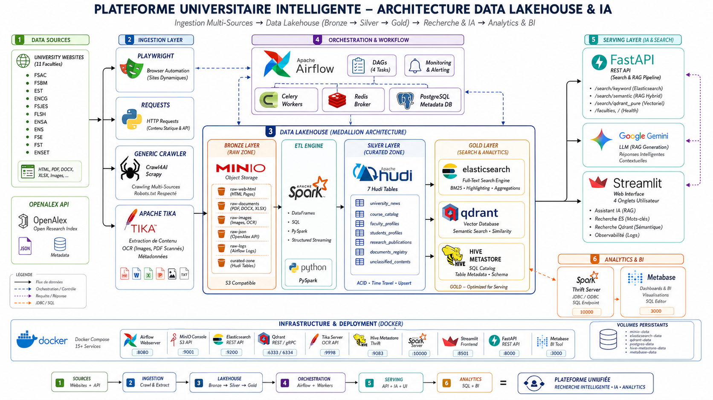

### Flux de Données

```
Sites Universitaires ──► Crawler (Playwright/Requests) ──► MinIO (Raw Zone)
                                                                │
OpenAlex API ──────────► Fetcher (Cursor Pagination) ──────────►│
                                                                │
                                                                ▼
                                                    Spark Silver (Tika + Nettoyage)
                                                                │
                                                                ▼
                                                            Apache Hudi
                                                          (Tables Silver)
                                                                │
                                                ┌───────────────┴───────────────┐
                                                ▼                               ▼
                                            Spark Gold                    Hive Metastore
                                                │                         (Catalogue SQL)
                                        ┌───────┴───────┐                       │
                                        ▼               ▼                       ▼
                                Elasticsearch      NLP + Chunking         Spark Thrift
                              (Index Full-Text)         │                  (JDBC/SQL)
                                                        ▼                       │
                                                      Qdrant                    ▼
                                                  (Vecteurs e5)              Metabase
                                                                             (KPI/BI)
```

---

## 🧰 Stack Technologique

| Composant | Technologie | Rôle |
|---|---|---|
| **Orchestration** | Apache Airflow (CeleryExecutor) | Planification et monitoring des pipelines |
| **Object Storage** | MinIO (S3-compatible) | Data Lake — zone brute (Raw) |
| **Processing** | Apache Spark 3.x (local mode) | Transformation Silver → Gold |
| **Table Format** | Apache Hudi | Upserts, déduplication, time-travel |
| **Catalogue** | Hive Metastore (PostgreSQL) | Exposition SQL des tables Hudi |
| **BI** | Metabase | Dashboards & KPIs interactifs |
| **Recherche Full-Text** | Elasticsearch 8.11 | Index inversé, highlighting, facettes |
| **Recherche Sémantique** | Qdrant | Stockage vectoriel (embeddings e5-small) |
| **NLP / Embedding** | `intfloat/multilingual-e5-small` | Vectorisation multilingue (FR/EN/AR) |
| **RAG / LLM** | Google Gemini (via API) | Génération de réponses augmentées |
| **API** | FastAPI | Endpoints REST (keyword, sémantique, RAG) |
| **Frontend** | Streamlit | Interface utilisateur + Observabilité |
| **Parsing** | Apache Tika (avec Tesseract OCR) | Extraction de texte (PDF, DOCX, HTML) |
| **Alerting** | SMTP (Gmail) | Notifications email sur échec de pipeline |

---

## 📋 Prérequis

- **Moteur Docker** avec Docker Compose v2 (au choix) :
  - *Windows / Mac* : **Docker Desktop**, ou **Colima**, ou **OrbStack**
  - *Linux / Windows WSL2* : **Docker Engine** natif
- **RAM allouée à Docker** : minimum **10 Go** (recommandé : 12 Go)
- **Espace disque** : ~15 Go pour les images Docker
- **(Optionnel)** Clé API Google Gemini pour le RAG : [https://aistudio.google.com/app/apikey](https://aistudio.google.com/app/apikey)

---

## 🚀 Installation & Lancement

### 1. Cloner le dépôt

```bash
git clone https://github.com/Oussama-Inchallah/University-Data-Platform-Mvp.git
cd University-Data-Platform-Mvp
```

### 2. Configurer les variables d'environnement

```bash
cp infra/docker/.env.example infra/docker/.env
```

Éditez `infra/docker/.env` et renseignez :
- `GEMINI_API_KEY` — votre clé API Google Gemini (optionnel, pour le RAG)
- `SMTP_PASSWORD` — mot de passe d'application Gmail (optionnel, pour les alertes email)

### 3. Lancer la plateforme

```bash
cd infra/docker
docker compose up -d --build
```

> ⏱️ Le premier build prend **15-20 minutes** (téléchargement des modèles NLP, Spark, Hudi).
> Les lancements suivants prennent **~2 minutes**.

### 4. Vérifier que tous les services sont opérationnels

```bash
docker compose ps
```

Tous les services doivent afficher `Up` ou `healthy`.

---

## 🧭 Accès aux Services

| Service | Rôle | URL | Identifiants |
|---|---|---|---|
| **Airflow** | Orchestration & Pipelines | [http://localhost:8080](http://localhost:8080) | `airflow` / `airflow` |
| **MinIO** | Data Lake (Stockage brut) | [http://localhost:9001](http://localhost:9001) | `minioadmin` / `minioadmin` |
| **Metabase** | BI & KPI Dashboards | [http://localhost:3000](http://localhost:3000) | *(configuré au 1er lancement)* |
| **Elasticsearch** | Moteur de Recherche | [http://localhost:9200](http://localhost:9200) | *(pas d'authentification)* |
| **Qdrant** | Base Vectorielle | [http://localhost:6333/dashboard](http://localhost:6333/dashboard) | *(pas d'authentification)* |
| **FastAPI (Swagger)** | API REST | [http://localhost:8000/docs](http://localhost:8000/docs) | N/A |
| **Streamlit** | Frontend & Observabilité | [http://localhost:8501](http://localhost:8501) | N/A |
| **Spark UI** | Monitoring Spark | [http://localhost:4041](http://localhost:4041) | N/A |

---

## ▶️ Exécution du Pipeline

### Lancer un pipeline complet (exemple : FSAC)

1. Ouvrez **Airflow** : [http://localhost:8080](http://localhost:8080)
2. Activez le DAG `ingest_raw_fsac` (toggle ON)
3. Cliquez sur **Trigger DAG** (bouton ▶)
4. Le pipeline exécute **4 tâches séquentielles** :

| # | Task ID | Phase | Description |
|---|---|---|---|
| 1 | `scrape_and_ingest_to_minio` | **Bronze** | Crawl du site web → stockage brut dans MinIO |
| 2 | `parse_and_normalize_to_hudi` | **Silver** | Parsing Tika + nettoyage → tables Apache Hudi |
| 3 | `embed_and_index_to_search` | **Gold** | Chunking NLP + embedding → Qdrant & Elasticsearch |
| 4 | `sync_hudi_to_hive_metastore` | **Analytics** | Synchronisation du catalogue Hive pour Metabase |

### Pipeline OpenAlex (données de recherche)

Le DAG `ingest_raw_openalex` interroge l'API OpenAlex pour récupérer les publications scientifiques associées à l'Université Hassan II.

### Liste complète des DAGs

| DAG ID | Université / Source |
|---|---|
| `ingest_raw_fsac` | Faculté des Sciences Ain Chock |
| `ingest_raw_fstm` | Faculté des Sciences et Techniques Mohammedia |
| `ingest_raw_fsj` | Faculté des Sciences Juridiques |
| `ingest_raw_fsbm` | Faculté des Sciences Ben M'Sik |
| `ingest_raw_fsk` | Faculté des Sciences Kénitra |
| `ingest_raw_fpl` | Faculté Polydisciplinaire Larache |
| `ingest_raw_fmpc` | Faculté de Médecine et Pharmacie |
| `ingest_raw_estc` | École Supérieure de Technologie |
| `ingest_raw_fsjesac` | FSJES Ain Chock |
| `ingest_raw_fsjesuca` | FSJES Casablanca |
| `ingest_raw_uh2c` | Université Hassan II (portail central) |
| `ingest_raw_openalex` | OpenAlex (publications scientifiques) |

---

## 📁 Structure du Projet

```
University-Data-Platform-Mvp/
│
├── dags/                              # DAGs Airflow (orchestration)
│   ├── dag_fsac.py                    # Pipeline Medallion pour FSAC
│   ├── dag_fstm.py                    # Pipeline Medallion pour FSTM
│   ├── dag_openalex.py                # Pipeline OpenAlex (API)
│   ├── ... (12 DAGs au total)
│   └── utils/
│       └── alerts.py                  # Système d'alertes email (DataOps)
│
├── docs/                              # Documentation
│   ├── RUNBOOK.md                     # Guide opérationnel
│   └── screenshots/                   # Preuves visuelles
│       ├── Architecture.png           # Diagramme d'architecture
│       ├── dashboards/                # Screenshots Metabase, Streamlit, RAG
│       ├── ingestion/                 # Screenshots Airflow, MinIO
│       └── processing/               # Screenshots Spark, Qdrant, ES
│
├── infra/docker/                      # Infrastructure
│   ├── docker-compose.yml             # Définition des 14+ services
│   ├── Dockerfile                     # Image Airflow + Spark + NLP
│   ├── Dockerfile.api                 # Image FastAPI
│   ├── Dockerfile.frontend            # Image Streamlit
│   ├── Dockerfile.hive                # Image Hive Metastore
│   ├── Dockerfile.tika                # Image Tika + OCR
│   ├── .env.example                   # Variables d'environnement modèle
│   └── requirements*.txt              # Dépendances Python
│
├── src/                               # Code source
│   ├── api/
│   │   └── search_rag_api.py          # API FastAPI (keyword, sémantique, RAG)
│   ├── frontend/
│   │   └── app.py                     # Interface Streamlit + Observabilité
│   ├── ingestion/
│   │   ├── crawler/
│   │   │   ├── engine.py              # Crawler web (Playwright + requests)
│   │   │   └── storage.py             # Gestionnaire MinIO (routage, ETags)
│   │   └── openalex/
│   │       └── fetcher.py             # Extracteur API OpenAlex
│   └── processing/
│       ├── config/
│       │   └── universal_routing.yaml # Règles de routage métier (YAML)
│       ├── core/
│       │   ├── config_loader.py       # Chargeur de configuration
│       │   ├── router.py              # Routeur de contenu
│       │   ├── parsers/               # Parsers (HTML, Document, JSON, Image)
│       │   ├── transformers/          # NLP, nettoyage, chunking
│       │   ├── writers/               # Hudi, Elasticsearch, Qdrant
│       │   └── utils/
│       │       └── platform_logger.py # Logger centralisé (DataOps)
│       └── jobs/
│           ├── process_raw_to_hudi.py # Job Spark Silver
│           ├── process_hudi_to_search.py # Job Spark Gold
│           └── sync_hudi_catalog.py   # Sync Hive Metastore
│
└── tests/                             # Tests
    ├── test_es_query.py               # Tests Elasticsearch
    └── test_es_score.py               # Tests scoring ES
```

---

## 🛡️ Fiabilité & Stabilité

La plateforme est conçue pour être **idempotente** et **tolérante aux pannes** :

| Mécanisme | Description |
|---|---|
| **Retries automatiques** | Chaque DAG est configuré avec `retries=1` et `retry_delay=5min` |
| **Catchup désactivé** | `catchup=False` empêche les exécutions en masse après un arrêt |
| **ETags Crawler** | Le crawler vérifie les ETags sur MinIO avant de re-télécharger un fichier |
| **Hudi Upserts** | Les tables Silver utilisent `UPSERT` avec clé primaire sur `url` → pas de doublons |
| **Alertes Email** | Chaque échec de tâche envoie un email détaillé avec le traceback complet |
| **Architecture Zero-OOM** | Streaming S3A (pas de `collect()`), traitement fichier-par-fichier pour éviter les dépassements mémoire |

### Sécurité de réexécution

Vous pouvez relancer le même DAG 10 fois : le résultat sera identique grâce aux Upserts Hudi et au mécanisme d'ETags du crawler.

---

## 📊 Qualité des Données & Traçabilité

| Aspect | Implémentation |
|---|---|
| **Schéma typé** | Tables Hudi avec colonnes : `doc_id`, `url`, `title`, `normalized_text`, `entity_type`, `language`, `source_system`, `ingestion_date` |
| **Déduplication** | Clé primaire `url` avec Hudi UPSERT + Index BLOOM |
| **Classification automatique** | Routeur YAML qui classe chaque document (cours, actualité, règlement, etc.) |
| **Détection de langue** | Module NLP qui identifie automatiquement FR/EN/AR |
| **Métadonnées complètes** | Chaque document porte : source, date d'ingestion, type, langue, système source |

---

## 📈 Utilité BI

Le dashboard **Metabase** est connecté via le **Spark Thrift Server** (JDBC) aux tables Hudi exposées dans le catalogue Hive.

**KPIs disponibles :**
- Volume de documents par faculté
- Répartition par type de contenu (cours, actualités, règlements, publications)
- Cartographie thématique de la recherche (Text Mining OpenAlex)
- Taux de contenu non classifié (Jauge de qualité)

**Screenshots :**

| Dashboard | Description |
|---|---|
| 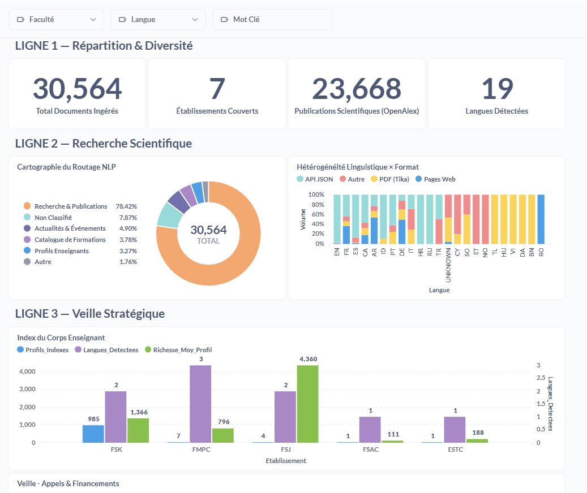 | Vue globale des KPIs |
| 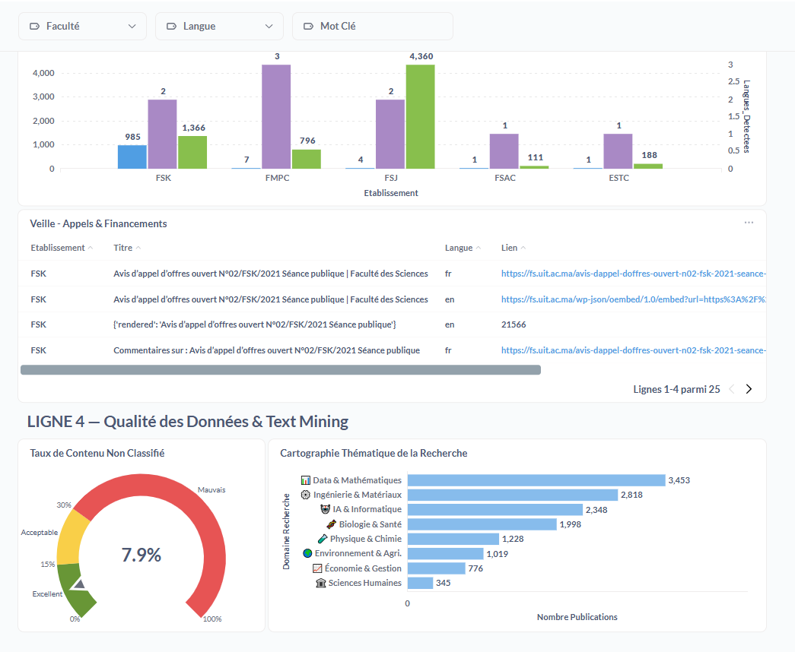 | Détail par faculté |

---

## 🔍 Qualité de la Recherche

L'API expose **3 modes de recherche** :

| Mode | Endpoint | Moteur | Description |
|---|---|---|---|
| **Keyword** | `GET /search/keyword` | Elasticsearch | Multi-champs pondérés, fuzzy, highlighting |
| **Sémantique** | `GET /search/semantic` | Qdrant + ES + Gemini | Hybride RRF + RAG (Gemini) |
| **Vectorielle pure** | `GET /search/qdrant_pure` | Qdrant | Similarité cosinus, filtres métadonnées |
| **Avancée** | `POST /search/qdrant_advanced` | Qdrant | Filtres dynamiques (type, faculté, langue) |

**Screenshots :**

| Interface | Description |
|---|---|
|  | Réponse RAG de l'assistant IA |
|  | Documentation API Swagger |

---

## ⚙️ Qualité d'Ingénierie

- **Organisation modulaire** : séparation claire `ingestion/` → `processing/core/` → `processing/jobs/` → `api/` → `frontend/`
- **Copyright © 2026** sur tous les fichiers
- **Docstrings professionnelles en français** sur chaque module et fonction
- **Configuration externalisée** : YAML pour le routage, `.env` pour les secrets
- **Architecture extensible** : ajouter une nouvelle université = créer 1 fichier DAG

---

## 🛠️ Maturité Opérationnelle

- **Runbook complet** : voir [`docs/RUNBOOK.md`](docs/RUNBOOK.md)
- **Observabilité intégrée** : onglet DataOps dans Streamlit (logs scraper, ETL, erreurs, métriques)
- **Déploiement one-command** : `docker compose up -d --build`
- **Alertes email** automatiques en cas d'échec de pipeline

---

## 📸 Preuves de Tests

### Ingestion (Airflow + MinIO)

| Preuve | Description |
|---|---|
| 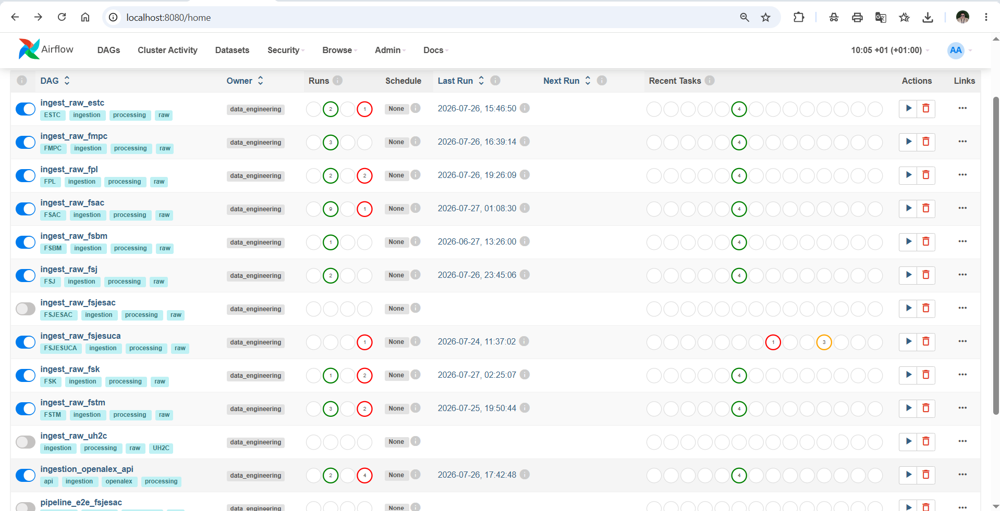 | Vue de l'interface Airflow avec les 12 DAGs |
| 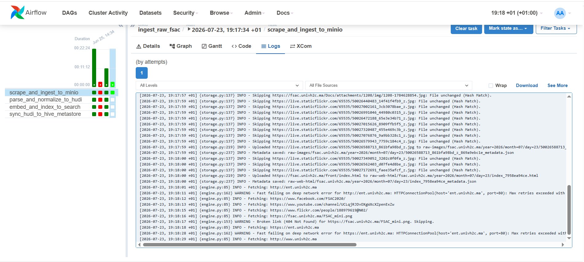 | Exécution réussie du pipeline FSAC |
| 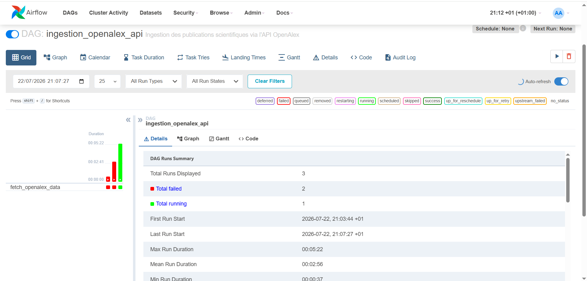 | Ingestion des publications OpenAlex |

### Processing (Spark + Qdrant + ES)

| Preuve | Description |
|---|---|
| 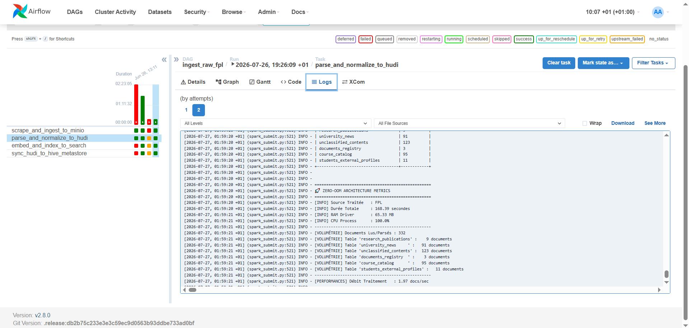 | Job Spark Silver en exécution |
| 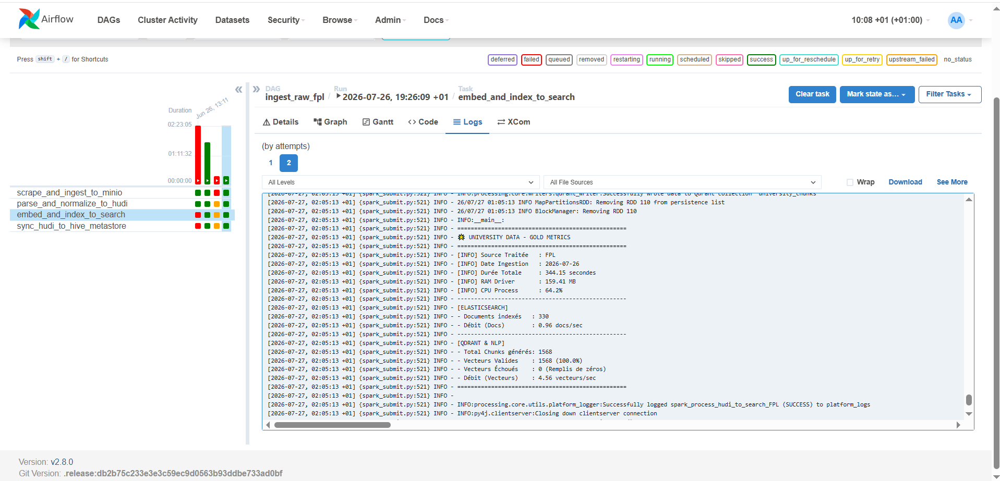 | Job Spark Gold (NLP + Embedding) |
| 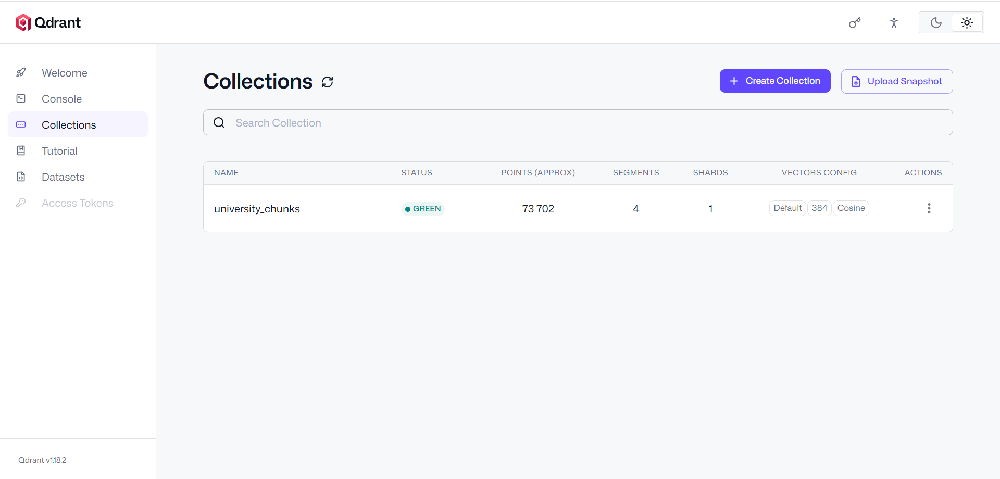 | Collections vectorielles dans Qdrant |
| 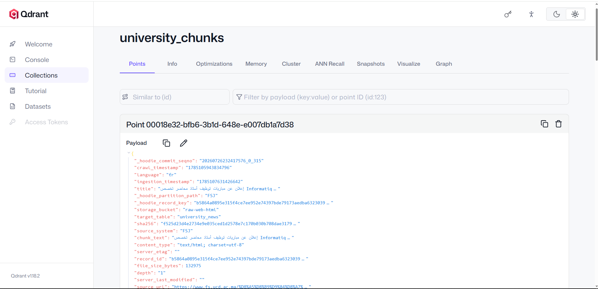 | Payload d'un chunk dans Qdrant |
| 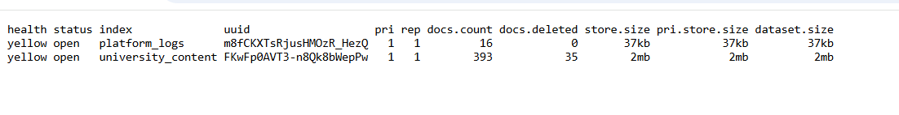 | Statistiques de l'index Elasticsearch |

### Dashboards & Recherche

| Preuve | Description |
|---|---|
|  | Dashboard BI Metabase |
|  | Onglet Observabilité Streamlit |
| 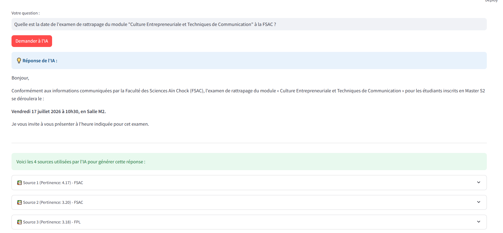 | Réponse RAG - Question 2 |
| 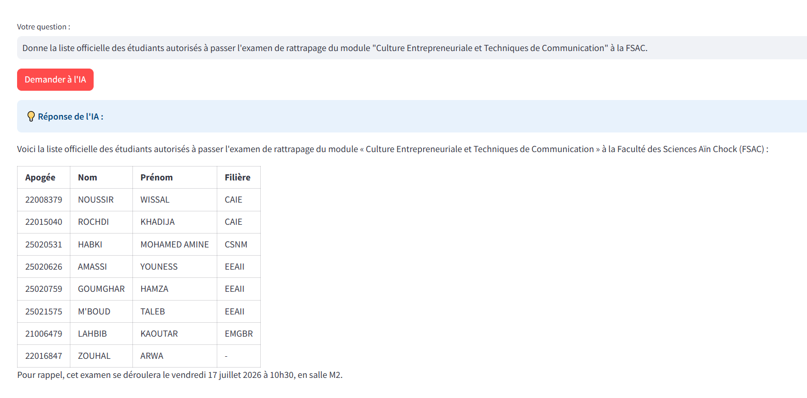 | Réponse RAG - Question 3 |
|  | Monitoring des erreurs d'ingestion |

---

## 📚 Documentation Complémentaire

- 📖 [**Runbook Opérationnel**](docs/RUNBOOK.md) — Exécuter, surveiller, récupérer

---

## 👥 Équipe

Projet réalisé dans le cadre du challenge **Best-of-9 MVP** — Université Hassan II de Casablanca.
