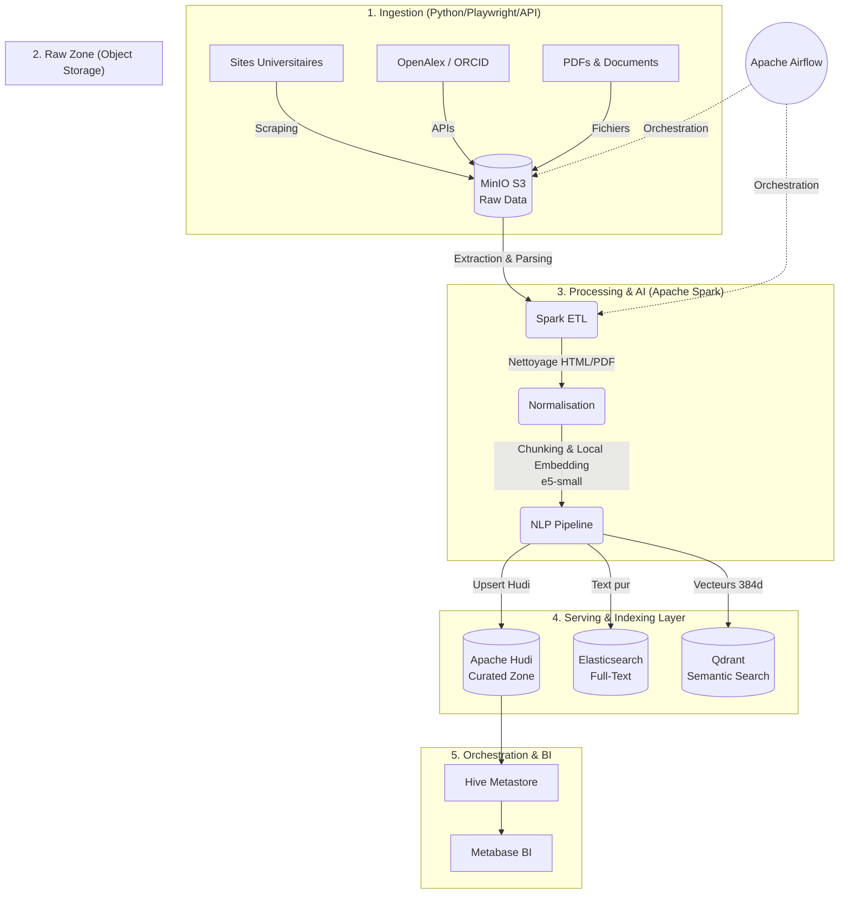

# 🎓 University Data Platform MVP

Une plateforme de données moderne, scalable et orientée IA conçue spécifiquement pour le contexte universitaire (scraping, analytique, recherche full-text, et RAG). 

Cette infrastructure unifie l'ingestion de données hétérogènes, le stockage Lakehouse, le traitement Big Data distribué, l'indexation sémantique et la Business Intelligence dans une architecture centralisée.

---

## 🏗️ Architecture Globale

La plateforme est construite autour de l'architecture **Medallion Lakehouse**, couplée à des moteurs de recherche avancés.



---

## 🛠️ Stack Technique

* **Orchestration :** Apache Airflow (CeleryExecutor)
* **Stockage Brut :** MinIO (S3-compatible)
* **Processing :** Apache Spark 3.5.1 (PySpark)
* **Format Lakehouse :** Apache Hudi
* **Catalogue de Données :** Apache Hive Metastore (PostgreSQL)
* **IA & NLP :** `sentence-transformers` (`intfloat/multilingual-e5-small`) via PySpark Iterator UDFs
* **Indexation Full-Text :** Elasticsearch 8.11
* **Recherche Vectorielle (RAG) :** Qdrant
* **Dataviz / BI :** Metabase

---

## ⚙️ Composants du Projet

La structure du code source est découpée selon les responsabilités métiers :

* `dags/` : Définition des workflows Apache Airflow (pipelines d'ingestion et de traitement).
* `infra/` : Fichiers d'infrastructure as code (Docker Compose, Dockerfiles, schémas).
* `src/ingestion/` : Scripts de collecte de données (Crawlers web, intégration OpenAlex).
* `src/processing/` : 
  * `core/parsers/` : Extracteurs de texte brut depuis HTML, PDF, etc.
  * `core/transformers/` : Traitements NLP (Chunking, Vectorisation locale).
  * `core/writers/` : Connecteurs de sortie (Hudi, Elastic, Qdrant).
  * `jobs/main.py` : Le point d'entrée principal des jobs Spark.

---

## 🚀 Installation & Démarrage

### Prérequis
* Docker et Docker Compose
* 16 Go de RAM minimum (alloués à Docker Desktop)
* 4+ Cœurs CPU

### Étape 1 : Préparation de l'environnement
Copiez le fichier `.env.example` en `.env` et configurez vos identifiants si nécessaire :
```bash
cp infra/docker/.env.example infra/docker/.env
```

### Étape 2 : Lancement des conteneurs
Rendez-vous dans le dossier de l'infrastructure Docker et lancez la commande de build :
```bash
cd infra/docker
docker compose build --no-cache  # Build de l'image (Airflow + Dépendances ML/NLP)
docker compose up -d
```

### Étape 3 : Accès aux Interfaces
Une fois les conteneurs démarrés, vous pouvez accéder aux différentes interfaces via votre navigateur :
* **Apache Airflow :** `http://localhost:8080` (Défaut : `airflow` / `airflow`)
* **MinIO Console :** `http://localhost:9001` (Défaut : `minioadmin` / `minioadmin`)
* **Qdrant Dashboard :** `http://localhost:6333/dashboard`
* **Elasticsearch :** `http://localhost:9200`
* **Metabase :** *(Déployé selon votre configuration infra)*

---

## 🧠 Le Pipeline NLP et RAG (Explication Technique)

Le pipeline Spark intègre une logique avancée pour transformer la donnée brute en connaissance interrogeable par IA :

1. **Extraction de Texte :** Nettoyage automatique des balises HTML et extraction des PDFs.
2. **Chunking :** Découpage sémantique du texte via Langchain.
3. **Modèle Local E5-Small :** Remplacement des APIs cloud coûteuses par le modèle Open Source `intfloat/multilingual-e5-small`. Ce modèle génère des vecteurs à **384 dimensions**, parfait pour les langues comme le Français, l'Arabe et l'Anglais.
4. **Optimisation PySpark OOM :** Le calcul vectoriel utilise des **Pandas UDFs Iterator** combinés à un bridage (`repartition(2)`) afin d'éviter les crashs de RAM (Out-Of-Memory) tout en exploitant les CPU locaux.

---

## 👁️ Validation et Suivi via Interfaces Web

La plateforme est conçue "UI-First". Vous n'avez pas besoin de lancer de scripts pour valider le traitement de la donnée. Tout est observable via les interfaces web déployées :

1. **Orchestration (Apache Airflow - Port 8080) :**
   - Suivi en temps réel de l'exécution du DAG `ingest_raw_fsac`.
   - Accès aux logs de chaque tâche Spark directement depuis l'interface UI.

2. **Data Lake (MinIO Console - Port 9001) :**
   - **Zone Brute :** Vérification visuelle des fichiers ingérés dans les buckets `raw-web-html`, `raw-documents`, etc.
   - **Zone Curée :** Validation de la création des tables Hudi et de leurs partitions temporelles.

3. **Recherche Sémantique (Qdrant Dashboard - Port 6333/dashboard) :**
   - Visualisation immédiate des points vectoriels.
   - Interface intégrée pour tester des requêtes sémantiques sur la collection `university_chunks`.

4. **Business Intelligence (Metabase - Port 3000) :**
   - Connexion directe au catalogue Apache Hive pour explorer les données traitées via une interface SQL visuelle ou glisser-déposer.

---

## 🛡️ Gouvernance et Sécurité des Données

* **Lignage de Données (Data Lineage) :** Chaque document stocké dans Hudi conserve l'empreinte exacte (`content_hash`) et l'URL source pour garantir la traçabilité complète de l'information jusqu'à sa source web initiale.
* **Isolation Storage/Compute :** L'architecture sépare strictement le calcul (Spark) du stockage (MinIO), permettant un redimensionnement asymétrique des nœuds en production.
* **Gestion des Formats Ouverts :** En s'appuyant sur Apache Hudi et Parquet, la plateforme évite tout "Vendor Lock-in", garantissant l'accessibilité pérenne des données académiques.

---

## 📊 Observabilité et Monitoring

* **Centralisation des Logs :** Les logs des exécutions Spark et Airflow sont automatiquement routés vers Elasticsearch pour une analyse post-mortem rapide.
* **Design "Idempotent" :** Les pipelines de données peuvent être rejoués à tout moment sans risque de duplication, grâce au moteur d'UPSERT natif d'Apache Hudi.
