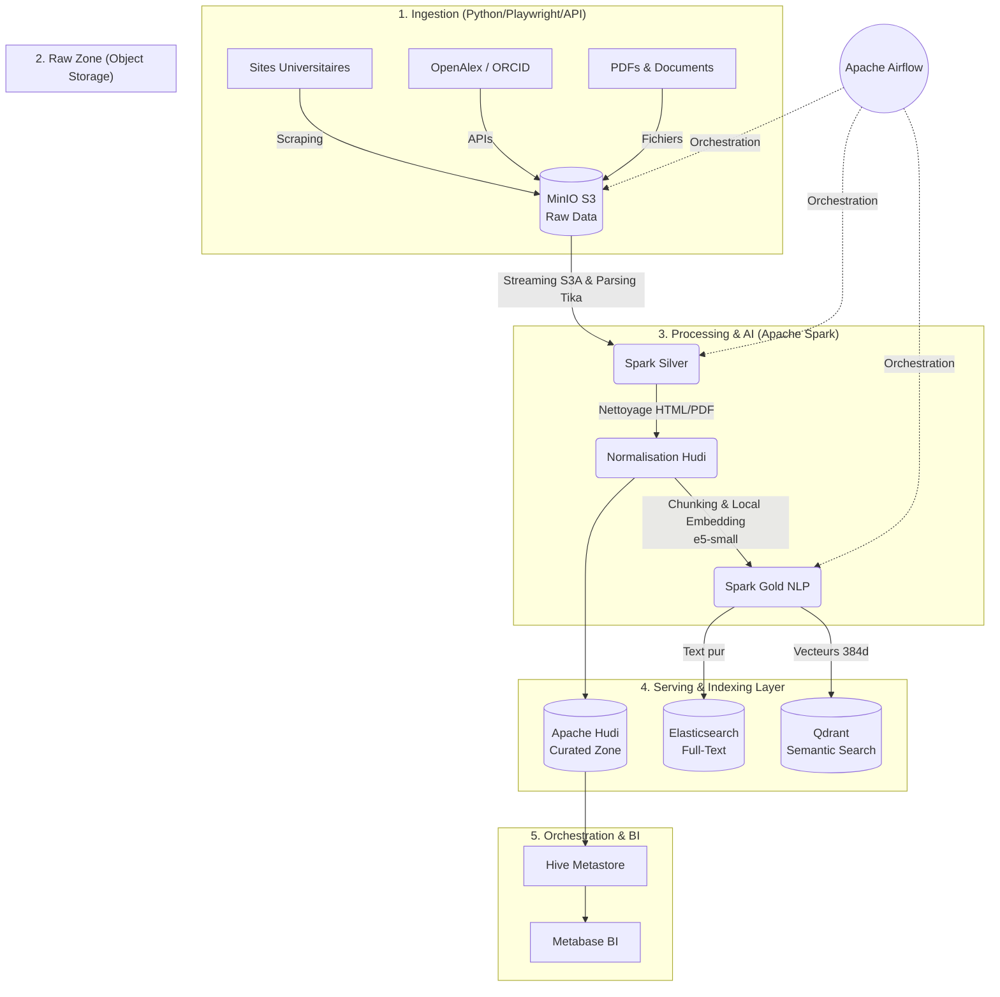
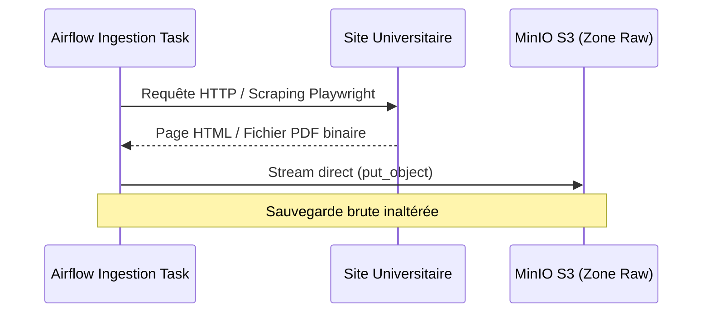
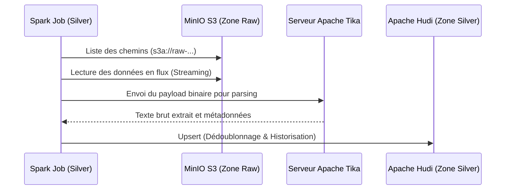
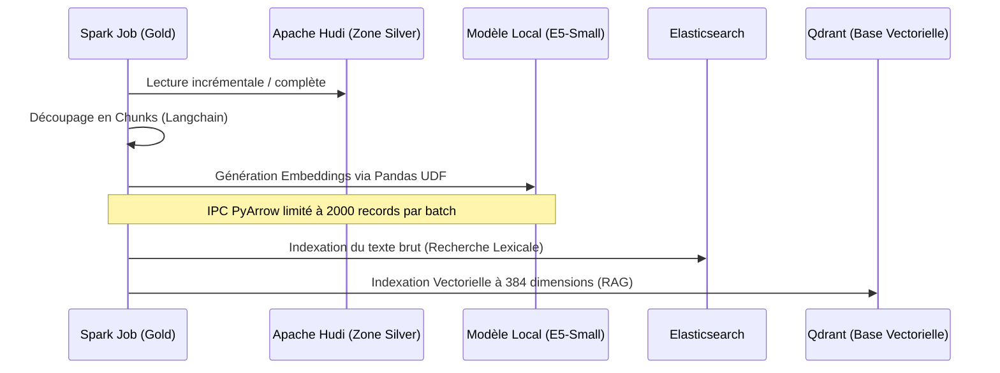

# 🎓 University Data Platform MVP

Une plateforme de données moderne, scalable et orientée IA conçue spécifiquement pour le contexte universitaire (scraping, analytique, recherche full-text, et RAG). 

Cette infrastructure unifie l'ingestion de données hétérogènes, le stockage Lakehouse, le traitement Big Data distribué, l'indexation sémantique et la Business Intelligence dans une architecture centralisée, **hautement optimisée pour la stabilité (Zero-OOM) sur des environnements locaux et contraints**.

---

## 🏗️ Architecture Globale

La plateforme est construite autour de l'architecture **Medallion Lakehouse**, couplée à des moteurs de recherche avancés.



---

## 🌊 Flux de Données (Data Flows)

La plateforme repose sur un flux de données (pipeline) découpé en phases strictes, garantissant résilience, scalabilité et traçabilité.

### Flux 1 : Ingestion (Collecte de la Donnée Brute)
Les Crawlers (Python/Playwright) extraient les données des sites universitaires. Les données brutes (fichiers HTML, PDF, Word, JSON) sont poussées **directement en streaming** vers MinIO sans charger d'énormes objets en mémoire.


### Flux 2 : Zone Silver (Nettoyage & Extraction Anti-OOM)
Afin d'éviter les crashs mémoire (OOM) sur les gros fichiers, ce flux utilise **Apache Spark en mode Streaming Binaire MinIO**. Spark ne charge plus l'intégralité des binaires en RAM, mais lit directement les flux S3 via la librairie boto3/S3A. Les fichiers riches (PDF) sont envoyés à Apache Tika.


### Flux 3 : Zone Gold (NLP, Vectorisation & Indexation)
Les données textuelles curées sont transformées en vecteurs mathématiques (Embeddings) pour l'Intelligence Artificielle. Le modèle HuggingFace est pré-compilé dans l'image Docker pour éviter toute latence réseau, et la communication PyArrow est bridée pour garantir la stabilité.


---

## 🛠️ Stack Technique & Optimisations Récentes

* **Orchestration :** Apache Airflow (CeleryExecutor)
* **Stockage Brut :** MinIO (S3-compatible)
* **Processing :** Apache Spark 3.5.1 (PySpark)
* **Format Lakehouse :** Apache Hudi
* **Catalogue de Données :** Apache Hive Metastore (PostgreSQL)
* **IA & NLP :** `sentence-transformers` (`intfloat/multilingual-e5-small`).
* **Indexation Full-Text :** Elasticsearch 8.11
* **Recherche Vectorielle (RAG) :** Qdrant

### 🔧 Optimisations de Stabilité (Juin 2026)
L'architecture a été profondément repensée pour fonctionner parfaitement sur des environnements Docker locaux sans erreurs de surcharge mémoire (`Exit Code -9` / `EOFException`) :
1. **Zero-Latency ML :** Le modèle HuggingFace est désormais directement gravé dans l'image Docker (Build time), supprimant totalement les délais de téléchargement de 5 minutes au démarrage des tâches.
2. **Mémoire JVM Restreinte :** Limitation volontaire à `driver-memory=1g` et exécution sur 1 seul cœur CPU (`local[1]`) pour la phase Gold, laissant de la RAM libre au travailleur Python (`Worker Python`).
3. **Micro-Batches PyArrow :** La taille des lots de transfert de données entre le moteur Java de Spark et les fonctions Python Pandas UDF a été drastiquement réduite (`spark.sql.execution.arrow.maxRecordsPerBatch=2000`) pour lisser l'empreinte RAM.
4. **Streaming S3 :** Abandon de la méthode `sparkContext.wholeTextFiles` au profit d'un pipeline de lecture MinIO boto3 asynchrone évitant le stockage des binaires dans le Driver Spark.

---

## ⚙️ Composants du Projet

La structure du code source est découpée selon les responsabilités métiers :

* `dags/` : Définition des workflows Apache Airflow (pipelines d'ingestion et de traitement).
* `infra/docker/` : Fichiers d'infrastructure as code (Docker Compose, Dockerfile).
* `src/ingestion/` : Scripts de collecte de données (Crawlers web structurés).
* `src/processing/` : 
  * `core/parsers/` : Extracteurs de texte brut (HTML BeautifulSoup, Tika PDF).
  * `core/transformers/` : Traitements NLP distribués (Chunking, Vectorisation locale).
  * `core/writers/` : Connecteurs de sortie massif (Hudi, Elasticsearch, Qdrant).
  * `jobs/` : Les points d'entrée principaux exécutés par Spark-Submit.

---

## 🚀 Installation & Démarrage

### Prérequis
* Docker et Docker Compose
* Au minimum 16 Go de RAM alloués à la machine virtuelle Docker (WSL2 sous Windows).
* Idéalement 4+ cœurs CPU alloués à Docker.

### Étape 1 : Préparation de l'environnement
Copiez le fichier `.env.example` en `.env` (si nécessaire) :
```bash
cp infra/docker/.env.example infra/docker/.env
```

### Étape 2 : Lancement des conteneurs
Rendez-vous dans le dossier de l'infrastructure Docker et lancez la compilation complète (le modèle IA sera téléchargé pendant cette phase) :
```bash
cd infra/docker
docker compose build --no-cache
docker compose up -d
```

### Étape 3 : Accès aux Interfaces
Une fois démarré, le projet met à disposition plusieurs tableaux de bord :
* **Apache Airflow :** `http://localhost:8080` (Défaut : `airflow` / `airflow`)
* **MinIO Console :** `http://localhost:9001` (Défaut : `minioadmin` / `minioadmin`)
* **Qdrant Dashboard :** `http://localhost:6333/dashboard`
* **Elasticsearch :** `http://localhost:9200`
* **Metabase BI :** `http://localhost:3000`

---

## 👁️ Suivi Visuel et Opérations

La plateforme est conçue "UI-First". Tout est observable en temps réel :

1. **Airflow (Port 8080) :**
   Déclenchez vos DAGs (ex: `ingest_raw_fsac`) et observez la progression visuellement. Les logs de chaque tâche Spark sont récupérés en direct.
2. **MinIO (Port 9001) :**
   Visualisez la zone d'atterrissage (`raw-web-html`) ou inspectez l'architecture physique de vos tables Apache Hudi dans le bucket `curated-zone`.
3. **Qdrant (Port 6333/dashboard) :**
   Explorez visuellement les points en 384 dimensions de la collection `university_chunks` générés par le pipeline NLP.
4. **Metabase (Port 3000) :**
   Création de tableaux de bords analytiques via le point de terminaison Spark Thrift Server (Metastore).

---

## 🛡️ Gouvernance et Sécurité des Données

* **Lignage de Données (Data Lineage) :** Chaque document stocké dans Hudi conserve l'empreinte exacte (`content_hash`) et l'URL source pour garantir la traçabilité complète de l'information jusqu'à sa source web initiale.
* **Isolation Storage/Compute :** L'architecture sépare strictement le calcul (Spark) du stockage (MinIO).
* **Format Ouvert (Lakehouse) :** En s'appuyant sur Apache Hudi et Parquet, la plateforme évite le "Vendor Lock-in" et maintient vos archives pérennes.
* **Design "Idempotent" :** Le pipeline peut crasher et être relancé 100 fois ; grâce au moteur d'UPSERT d'Hudi et à l'écrasement des Index ID dans Elasticsearch/Qdrant, vous n'aurez **jamais** de doublons dans la plateforme.
