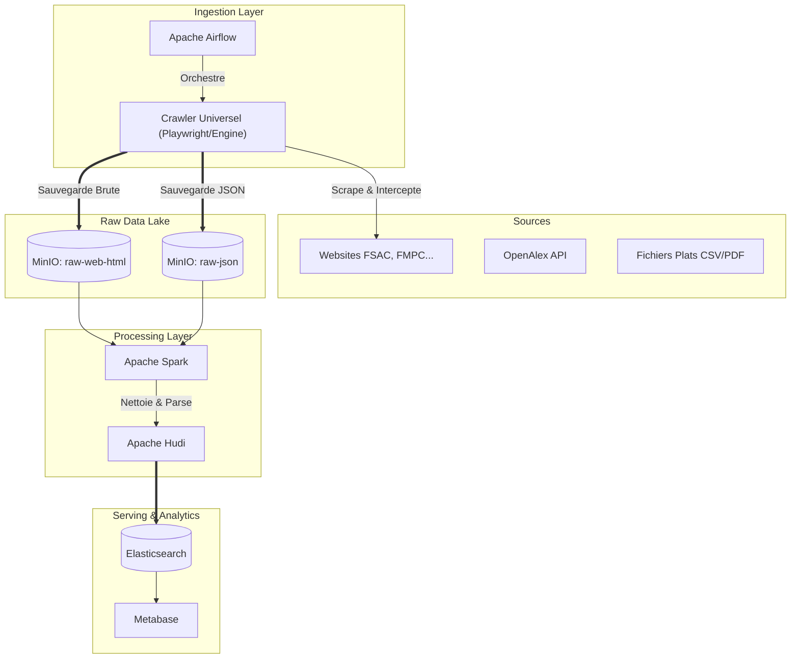

# 📘 Documentation Officielle : University Data Platform MVP

**Table des Matières**
1. [Présentation générale du projet](#1-présentation-générale-du-projet)
2. [Architecture globale](#2-architecture-globale)
3. [Structure du projet](#3-structure-du-projet)
4. [Infrastructure](#4-infrastructure)
5. [Partie Ingestion de données](#5-partie-ingestion-de-données)
6. [Partie Traitement des données](#6-partie-traitement-des-données)
7. [Stockage des données](#7-stockage-des-données)
8. [Partie Programmation](#8-partie-programmation)
9. [Orchestration et Automatisation](#9-orchestration-et-automatisation)
10. [Sécurité](#10-sécurité)
11. [Monitoring et Observabilité](#11-monitoring-et-observabilité)
12. [Fonctionnalités actuelles](#12-fonctionnalités-actuelles)
13. [Roadmap et Évolutions futures](#13-roadmap-et-évolutions-futures)
14. [Guide pour les développeurs](#14-guide-pour-les-développeurs)
15. [Conclusion](#15-conclusion)

---

## 1. Présentation générale du projet

### Objectif du projet
Le projet **University Data Platform MVP** a pour but de créer une plateforme de données (Data Lakehouse) centralisée et automatisée, capable de collecter, traiter et restituer toutes les informations relatives au monde universitaire (publications, profils des professeurs, actualités des facultés, données de recherche, etc.).

### Problématique résolue
Les données universitaires sont actuellement silotées, non structurées et dispersées sur de multiples sites web (sites de facultés, catalogues de recherche comme OpenAlex). Ce projet casse ces silos en offrant un point d'accès unique, nettoyé et requêtable pour les chercheurs, les étudiants et l'administration.

### Vision globale
La vision fondamentale est double : d'une part, **centraliser l'intégralité du contenu dispersé des universités et facultés dans une seule et unique base de données massive** (Single Source of Truth). D'autre part, exploiter ce Data Lake exceptionnel pour **entraîner des modèles d'Intelligence Artificielle (IA)** capables de comprendre, d'analyser et d'interagir intelligemment avec ces connaissances académiques.

### Cas d'utilisation
- **Assistants Virtuels (IA) :** Création de chatbots intelligents basés sur nos modèles entraînés (type RAG - Retrieval-Augmented Generation) pour répondre instantanément aux questions complexes des étudiants ou du personnel.
- **Moteur de Recommandation Académique :** Algorithmes d'IA suggérant à un étudiant le meilleur master ou le bon professeur encadrant selon son profil.
- **Recherche Avancée & Veille :** Moteur de recherche puissant (Elasticsearch) cherchant à travers toutes les universités centralisées (publications, événements, annonces).
- **Analyse Prédictive :** Tableaux de bord intelligents pour aider les décideurs à anticiper les tendances de recherche ou les besoins administratifs.

### Public cible
- **Étudiants & Futurs Bacheliers :** Bénéficiant de l'IA pour s'orienter, trouver des informations administratives ou chercher un encadrant.
- **Chercheurs & Professeurs :** Trouvant des publications centralisées et des opportunités de synergie entre départements.
- **Administration & Décideurs Universitaires :** Pilotage centralisé de la donnée pour des statistiques globales fiables.
- **Data Scientists & Développeurs IA :** Disposant d'un jeu de données riche et structuré, prêt pour l'entraînement de nouveaux modèles (NLP, Machine Learning).

---

## 2. Architecture globale

### Vue d'ensemble de l'architecture
L'architecture suit un modèle **Data Lakehouse** moderne, divisée en trois couches logiques :
1. **Bronze (Raw) :** Ingestion des données brutes (Scraping HTML, JSON d'API) stockées telles quelles dans un Data Lake (MinIO).
2. **Silver (Cleaned) :** Nettoyage, parsing et normalisation des données via Apache Spark (stockage Hudi).
3. **Gold (Serving) :** Données métier prêtes à l'emploi, indexées dans Elasticsearch ou servies via PostgreSQL pour Metabase.

### Diagramme d'architecture



### Flux de données
1. **Collecte :** Les DAGs Airflow déclenchent directement le moteur universel (`plugins/crawler/engine.py`).
2. **Atterrissage :** Le crawler télécharge le code brut (HTML, JSON, PDF) et le dépose dans les buckets MinIO.
3. **Traitement :** Des jobs Spark (futurs) liront ces buckets, extrairont l'information utile et écriront des tables Hudi.
4. **Restitution :** Les tables Hudi sont exportées vers Elasticsearch pour permettre une recherche plein texte rapide.

---

## 3. Structure du projet

L'arborescence respecte la **Séparation des Préoccupations (Separation of Concerns)** :

```text
University-Data-Platform-Mvp/
├── infra/                  # Infrastructure as Code (Docker, .env, DDL)
├── dags/                   # Orchestration Centrale (DAGs Airflow)
├── plugins/                # Code Custom Airflow (Moteur du Crawler)
├── src/                    # Logique Métier Indépendante (Agnostique d'Airflow)
├── tests/                  # Tests unitaires et d'intégration
├── docs/                   # Documentation globale et captures d'écran
└── scripts/                # Scripts utilitaires Bash/PowerShell
```

### Rôle de chaque dossier
- **`infra/` :** Contient tout ce qui concerne le déploiement (Docker Compose, Dockerfile custom, configurations Metabase/Elastic).
- **`dags/` :** Ne contient *que* la définition des flux de travail (les dépendances entre les tâches). Pas de logique métier complexe ici.
- **`plugins/crawler/` :** Contient toute l'intelligence d'ingestion. C'est le moteur universel de scraping basé sur Playwright.
- **`src/` :** Réservé pour la future logique de traitement de données (PySpark, Hudi) totalement indépendante d'Airflow. Actuellement vidé des anciens scripts de scraping spécifiques pour favoriser l'approche universelle.

---

## 4. Infrastructure

L'infrastructure locale est entièrement conteneurisée pour garantir la reproductibilité.

### Docker et Docker Compose
Le projet utilise un fichier central `docker-compose.yml` situé dans `infra/docker/`. 
Afin d'éviter de lancer des services inutiles pour certaines tâches, l'infrastructure utilise les **Profils Docker** :
- **`--profile ingestion` :** Lance Airflow, Redis, Postgres et MinIO.
- **`--profile processing` :** (Futur) Lancera les clusters Spark.

### Réseau interne
Tous les conteneurs partagent un pont réseau Docker (`bridge`). Les services communiquent entre eux via leurs noms d'hôtes (ex: `http://minio:9000` ou `postgresql://postgres:5432`).

### Volumes
Des "Named Volumes" sont utilisés pour assurer la persistance des données même si les conteneurs sont détruits :
- `postgres-data` : Sauvegarde des métadonnées Airflow.
- `minio-data` : Sauvegarde du Data Lake.

### Variables d'environnement
Gérées via un fichier `.env` non versionné (voir `.env.example`). Ce fichier contient les mots de passe de MinIO et d'Airflow.

---

## 5. Partie Ingestion de données

La couche d'ingestion est conçue pour être résiliente et agnostique.

### Fonctionnement du Crawler Universel
L'ingestion a été entièrement refondue pour utiliser un moteur unique situé dans `plugins/crawler/engine.py`. Nous utilisons une approche de **"Dumb Scraping"** (Scraping bête) lors de l'ingestion :
- Le moteur navigue sur les sites dynamiques (avec Playwright) et intercepte le trafic réseau.
- Il télécharge l'intégralité de la page HTML et des documents utiles (PDF, JSON interceptés) sans essayer de les parser immédiatement.
- **Pourquoi ?** Si la structure du site change, le processus de collecte ne plante pas. Le parsing métier est reporté à l'étape de traitement (Spark).

### Sources de données
1. **Web (HTML/Réseau) :** Sites des facultés (FSAC, UH2C, FMPC, etc.). Le crawler télécharge automatiquement les pages, les PDFs et les réponses API qu'il croise en naviguant.

### Gestion des métadonnées (Sidecar Pattern)
Chaque document ingéré dans MinIO est accompagné d'un fichier de métadonnées. 
Exemple pour une page scrapée :
- `doyen.html` (Le contenu brut).
- `doyen_metadata.json` (Contient la date de l'ingestion, l'URL source, le code HTTP, et la méthode de collecte).

---

## 6. Partie Traitement des données (Processing)

*(Note : Cette section représente le cœur de la phase 2 du MVP)*

### Pipeline de traitement
Une fois les données brutes dans MinIO, Apache Spark entre en jeu pour créer les couches Silver et Gold.

1. **Nettoyage :** Suppression des balises HTML inutiles, des scripts Javascript (via BeautifulSoup dans des UDF Spark).
2. **Normalisation :** Conversion des dates au format ISO 8601, standardisation des noms des facultés.
3. **Enrichissement :** Croisement des données (ex: relier un professeur trouvé sur le site FSAC avec ses publications trouvées sur OpenAlex).
4. **Validation :** Filtrage des enregistrements mal formés ou incomplets (Data Quality).

---

## 7. Stockage des données

### MinIO (S3-Compatible Data Lake)
MinIO est utilisé comme stockage objet distribué. Il agit exactement comme AWS S3.

### Organisation des buckets
Les données sont rigoureusement classées par type technique à l'ingestion :
- `raw-web-html/` : Pour le code source des sites.
- `raw-json/` : Pour les réponses des APIs.
- `raw-documents/` : Pour les PDF et Excels.
- `raw-images/` : Pour les logos, photos des professeurs.

> [!TIP]
> Dans chaque bucket, l'organisation est partitionnée temporellement : `raw-web-html/fsac/2026/06/12/`.

---

## 8. Partie Programmation

### Stack Technologique
- **Langages :** Python 3.10+
- **Orchestration :** Apache Airflow 2.9
- **Scraping :** Playwright (Rendu JS), BeautifulSoup 4, Requests.
- **Infrastructure :** Docker, Docker Compose, Bash/PowerShell.

### Standards de développement
- L'ingestion est exclusivement gérée par le moteur universel (`plugins/crawler/engine.py`). Plus aucun script de scraping spécifique (spaghetti code) n'est autorisé.
- Séparation stricte entre l'**Extract** (géré par le Crawler Universel via Airflow) et le **Transform** (qui sera géré par Spark dans `src/`).

---

## 9. Orchestration et Automatisation

### Apache Airflow
Airflow agit comme le chef d'orchestre de toute la plateforme.

### Les DAGs
Les DAGs (Directed Acyclic Graphs) sont définis dans `dags/ingestion/`. 
On y trouve un DAG par source (ex: `dag_fsac.py`, `dag_openalex.py`). Ils sont généralement programmés pour s'exécuter une fois par semaine (`@weekly`) ou quotidiennement (`@daily`) selon la fréquence de mise à jour de la source.

### Gestion des logs et erreurs
- Airflow conserve l'historique complet de chaque tâche dans `infra/docker/airflow-logs/`.
- Les DAGs sont configurés avec des `retries` (généralement 2 essais espacés de 5 minutes) en cas d'erreur réseau temporaire (Timeout API).

---

## 10. Sécurité

### Gestion des secrets
Absolument aucun mot de passe n'est stocké dans le code source. 
- Au niveau local, le fichier `.env` injecte les variables.
- Dans Airflow, les clés API (comme un token OpenAlex si nécessaire) doivent être stockées dans les **Airflow Connections** ou les **Airflow Variables**.

---

## 11. Monitoring et Observabilité

*(À venir dans la phase de mise en production)*
Le système sera monitoré par :
- Les dashboards natifs d'Airflow (suivi de la durée des tâches, des échecs).
- À terme, intégration possible de Prometheus/Grafana pour surveiller l'état de santé de MinIO, Spark et Postgres.

---

## 12. Fonctionnalités actuelles

### 1. Ingestion Universelle (Web Crawler Intelligent)
Un moteur unique et robuste (`plugins/crawler/engine.py`) capable de parcourir n'importe quel site académique, de résoudre les liens relatifs, d'intercepter le trafic réseau (requêtes API internes) et de télécharger les pages HTML et documents. Cette logique a remplacé les dizaines de scripts spécifiques qu'il fallait maintenir auparavant.

### 2. Architecture Modulaire via Profils Docker
Possibilité de démarrer l'infrastructure à la carte (`ingestion` seulement, sans consommer la RAM pour Spark ou Elastic).

---

## 13. Roadmap et Évolutions futures

### Phase 2 : Processing & Data Lakehouse
- Déploiement du cluster Apache Spark.
- Implémentation du format Apache Hudi pour gérer les *Upserts* (Mises à jour) dans le Data Lake.

### Phase 3 : Serving & Analytics
- Déploiement d'Elasticsearch et synchronisation avec Hudi.
- Déploiement de Metabase pour créer des tableaux de bord interactifs (Publications par faculté, tendances de mots-clés de recherche).

### Améliorations IA (Futur)
- Intégration de LLM (Large Language Models) pour faire du résumé automatique des articles scientifiques récupérés.

---

## 14. Guide pour les développeurs

### Lancement Local (Quickstart)

1. **Cloner le projet**
   ```bash
   git clone https://github.com/Oussama-Inchallah/University-Data-Platform-Mvp.git
   cd University-Data-Platform-Mvp
   ```

2. **Configuration**
   ```bash
   cd infra/docker
   cp .env.example .env
   # Modifier les mots de passe si besoin
   ```

3. **Build et Démarrage**
   ```bash
   docker compose --profile ingestion up -d --build
   ```

4. **Accès**
   - Airflow : `http://localhost:8080` (Identifiants : `airflow` / *votre_mdp*)
   - MinIO : `http://localhost:9001` (Identifiants : `minioadmin` / *votre_mdp*)

### Bonnes pratiques de Contribution
- Créez toujours une branche depuis `dev` (ex: `feature/ajouter-dag-faculte`).
- Ne touchez jamais à la branche `main` directement.
- Respectez l'architecture : L'ingestion est gérée par le **Crawler Universel** dans `plugins/crawler/`. Ne créez plus de scripts de scraping custom. Pour ajouter une source, il suffit de créer un nouveau DAG dans `dags/` qui appelle le crawler avec la bonne URL.

---

## 15. Conclusion

Le projet **University Data Platform MVP** pose des bases d'ingénierie des données de niveau entreprise. En adoptant les standards de l'industrie (Docker, Airflow, architecture Lakehouse, MinIO, séparation des préoccupations), le projet est conçu pour être infiniment scalable.

La vision à long terme est d'offrir la cartographie la plus exhaustive et intelligente de la recherche et de la vie universitaire, en transformant des milliers de pages web chaotiques en données exploitables et valorisables.
